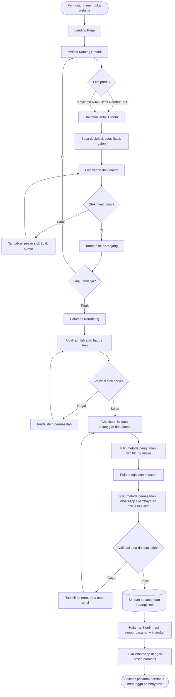
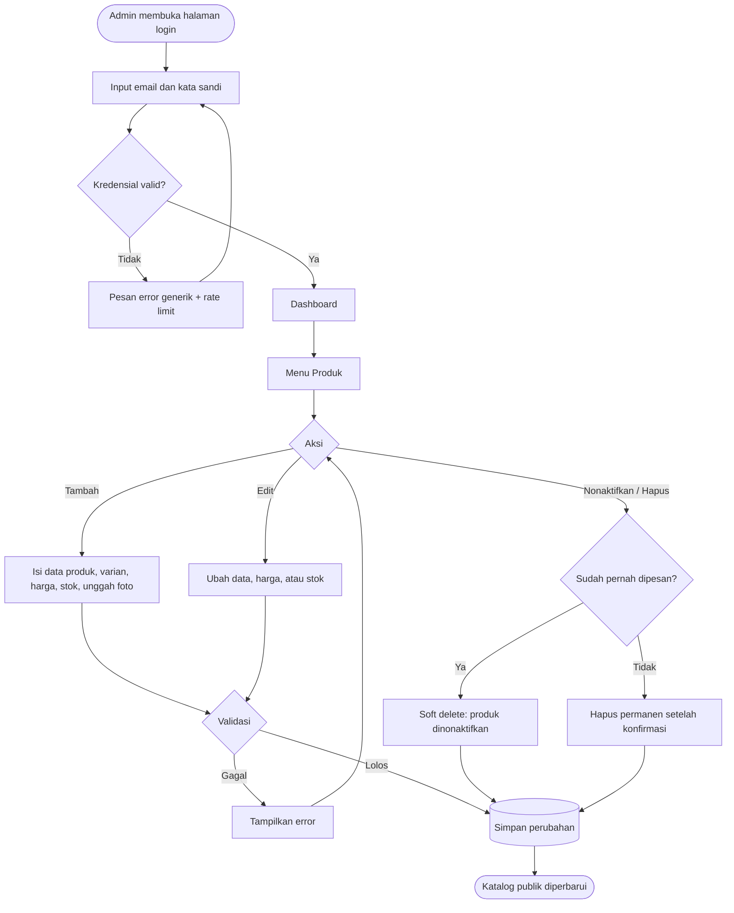
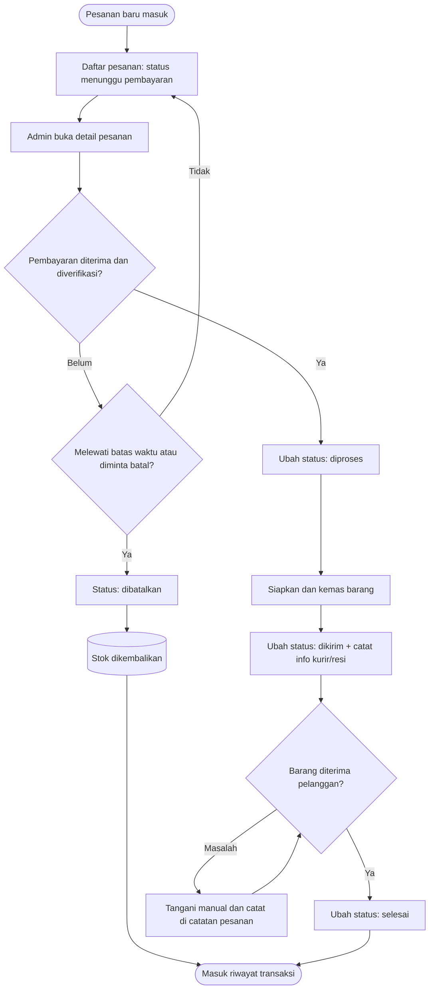
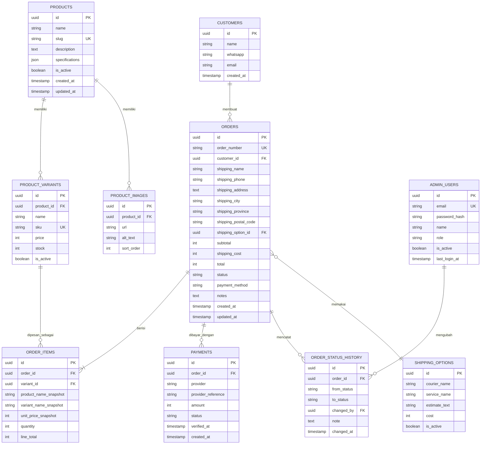
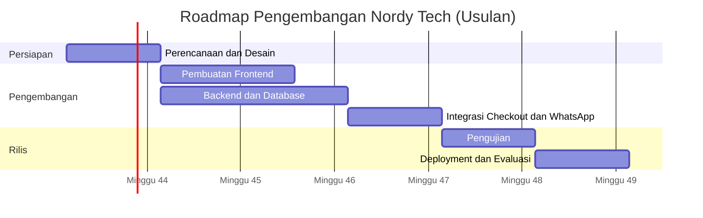

# Product Requirements Document (PRD)
## Website E-Commerce Nordy Tech

| Atribut | Keterangan |
|---|---|
| Nama Produk | Nordy Tech E-Commerce Website |
| Versi Dokumen | 1.0 (Draft untuk review pemilik bisnis) |
| Tanggal | 11 Oktober 2026 |
| Status | Draft |
| Dokumen Terkait | `design.md` (acuan visual, sudah dimiliki; tidak dibahas ulang di PRD ini) |
| Mata Uang / Bahasa | IDR (Rupiah) / Bahasa Indonesia |

> **Konvensi dokumen**
> - **TBD** = belum diketahui, perlu dikonfirmasi pemilik bisnis.
> - **[Placeholder]** = contoh data yang dapat diubah administrator, bukan data nyata.
> - **[Usulan]** = angka atau keputusan awal yang perlu divalidasi.
> - Prioritas: **MUST** (wajib MVP), **SHOULD**, **COULD**.

---

## Daftar Isi

1. [Product Overview](#a-product-overview)
2. [Problem Statement](#b-problem-statement)
3. [User Personas](#c-user-personas)
4. [User Stories](#d-user-stories)
5. [Functional Requirements](#e-functional-requirements)
6. [Non-Functional Requirements](#f-non-functional-requirements)
7. [UI/UX Requirements](#g-uiux-requirements)
8. [User Flow](#h-user-flow)
9. [Data Model dan Database](#i-data-model-dan-database)
10. [Business Rules](#j-business-rules)
11. [Technical Requirements](#k-technical-requirements)
12. [MVP Scope](#l-mvp-scope)
13. [Acceptance Criteria](#m-acceptance-criteria)
14. [Success Metrics](#n-success-metrics)
15. [Risks and Assumptions](#o-risks-and-assumptions)
16. [Development Roadmap](#p-development-roadmap)

---

## A. Product Overview

### A.1 Latar Belakang Bisnis
Nordy Tech adalah bisnis e-commerce kecil yang menjual aksesori berbasis komponen teknologi dengan konsep persilangan antara dunia elektronik dan fashion. Katalog sengaja dibatasi pada **dua produk saja**:

1. **Jepit Rambut PCB**: aksesori rambut dengan PCB (Printed Circuit Board) sebagai elemen desain utama.
2. **Keychain RJ45**: gantungan kunci bertema konektor jaringan RJ45, ditujukan bagi penggemar teknologi, jaringan komputer, dan IT.

Saat ini belum ada kanal penjualan terpusat yang menampilkan brand, katalog, stok, dan proses pemesanan secara konsisten. Website ini menjadi etalase sekaligus sistem pemesanan resmi Nordy Tech.

### A.2 Masalah yang Ingin Diselesaikan
- Pelanggan sulit menemukan aksesori bertema teknologi yang unik dan layak dijadikan hadiah.
- Informasi produk, harga, dan ketersediaan stok tersebar dan tidak konsisten.
- Pemesanan manual lewat chat rawan salah catat, lambat, dan sulit dilacak.
- Pemilik bisnis belum punya satu tempat untuk mengelola produk, stok, dan status pesanan.

### A.3 Solusi yang Ditawarkan
Website e-commerce sederhana yang menyediakan:
- Katalog dan detail produk yang jelas, dengan stok yang akurat.
- Keranjang dan checkout ringkas dengan opsi pemesanan awal melalui WhatsApp.
- Penyimpanan pesanan terstruktur dengan nomor pesanan unik dan status yang dapat dilacak.
- Dashboard admin untuk mengelola produk, harga, stok, dan pesanan.

### A.4 Visi dan Tujuan Produk
**Visi:** Menjadi toko aksesori bertema teknologi yang paling mudah ditemukan dan dipercaya oleh komunitas penggemar teknologi di Indonesia.

**Tujuan produk (terukur dan dapat diuji):**

| # | Tujuan | Indikator |
|---|---|---|
| 1 | Menampilkan kedua produk secara profesional | Katalog dan detail produk tampil lengkap untuk 100% produk aktif |
| 2 | Memudahkan pemesanan | Pelanggan dapat menyelesaikan checkout dalam ≤ 5 langkah dari halaman produk |
| 3 | Membangun identitas brand | Seluruh halaman konsisten dengan `design.md` |
| 4 | Memudahkan pengelolaan bisnis | Admin dapat mengubah harga, stok, dan status pesanan tanpa bantuan developer |

### A.5 Unique Value Proposition (UVP)
> **"Aksesori yang lahir dari komponen teknologi: dipakai sebagai gaya, dikenali sebagai identitas."**

Nordy Tech menjual barang yang menyatukan estetika elektronik dan fashion, sehingga pemakainya langsung terbaca sebagai bagian dari komunitas teknologi.

### A.6 Keunggulan Dibandingkan Toko Aksesori Biasa

| Aspek | Toko aksesori umum | Nordy Tech |
|---|---|---|
| Konsep produk | Generik, tren umum | Berbasis komponen teknologi (PCB, RJ45) |
| Target pasar | Luas, tidak spesifik | Komunitas teknologi dan pencari hadiah bertema IT |
| Katalog | Ratusan item, membingungkan | Fokus dua produk, mudah dipilih |
| Pengalaman beli | Bervariasi | Alur singkat, stok jelas, opsi WhatsApp |
| Identitas brand | Tidak khas | Konsisten, minimalis, tech-inspired |

---

## B. Problem Statement

**Pengguna** yang menyukai teknologi dan mencari aksesori unik **mengalami kesulitan** menemukan produk bertema elektronik dan jaringan komputer yang menarik secara estetika, jelas ketersediaannya, dan mudah dibeli secara online. Marketplace umum didominasi aksesori generik, sedangkan penjual tema teknologi umumnya hanya melayani lewat chat tanpa katalog, kejelasan stok, dan pelacakan pesanan.

**Dampaknya:** calon pembeli gagal menemukan hadiah atau aksesori yang sesuai identitasnya, pembelian tertunda karena informasi tidak jelas, dan penjual kehilangan penjualan akibat proses pemesanan yang manual.

**Hasil yang diharapkan:** satu website yang membuat pengunjung memahami produk dalam hitungan detik, memesan tanpa hambatan, dan membuat pemilik bisnis mengelola pesanan secara rapi.

---

## C. User Personas

> Persona berikut adalah **hipotesis awal** berdasarkan target pengguna yang ditetapkan, bukan hasil riset. Validasi dengan wawancara atau data pembeli nyata (TBD).

### Persona 1: Raka, Mahasiswa Teknik Informatika
| Atribut | Detail |
|---|---|
| Usia / Peran | 20 tahun, mahasiswa jurusan jaringan/komputer |
| Perangkat | Smartphone (utama), laptop |
| Kebutuhan | Aksesori yang mencerminkan minatnya di bidang jaringan dan IT |
| Tujuan | Membeli Keychain RJ45 untuk dirinya atau teman satu angkatan |
| Kendala | Anggaran terbatas, ragu dengan toko yang tidak punya info stok dan harga jelas |
| Perilaku | Mengecek harga dulu, menyukai pembayaran sederhana dan konfirmasi via WhatsApp |

### Persona 2: Dinda, Pencari Hadiah untuk Pasangan/Teman Tech
| Atribut | Detail |
|---|---|
| Usia / Peran | 24 tahun, pekerja kantoran non-teknis |
| Perangkat | Smartphone |
| Kebutuhan | Hadiah unik bertema teknologi yang tampak niat dan estetik |
| Tujuan | Membeli Jepit Rambut PCB dan/atau Keychain RJ45 sebagai hadiah |
| Kendala | Tidak paham istilah teknis (PCB, RJ45), butuh deskripsi yang mudah dimengerti dan foto yang jelas |
| Perilaku | Butuh yakin soal ukuran, bahan, dan kepastian barang sampai tepat waktu |

### Persona 3: Sari, Penggemar Elektronik dan Aksesori Kreatif
| Atribut | Detail |
|---|---|
| Usia / Peran | 22 tahun, hobiis elektronik dan DIY |
| Perangkat | Smartphone dan tablet |
| Kebutuhan | Aksesori rambut yang unik dan berbeda dari yang umum |
| Tujuan | Membeli Jepit Rambut PCB sebagai pelengkap gaya |
| Kendala | Ingin tahu detail desain dan pilihan varian sebelum membeli |
| Perilaku | Membandingkan foto dari berbagai sudut, memilih varian dengan teliti |

### Persona 4: Bu Maya, Pemilik Bisnis / Administrator
| Atribut | Detail |
|---|---|
| Peran | Pemilik dan satu-satunya operator awal |
| Kebutuhan | Mengelola produk, stok, dan pesanan tanpa keahlian teknis |
| Tujuan | Menerima pesanan rapi, menghindari oversell, memantau penjualan |
| Kendala | Waktu terbatas, mencatat pesanan manual dari chat rawan salah |

---

## D. User Stories

### D.1 Pelanggan

| ID | User Story | Prioritas |
|---|---|---|
| US-01 | Sebagai pengunjung, saya ingin melihat landing page yang menjelaskan brand dan produk, sehingga saya langsung paham apa yang dijual Nordy Tech. | MUST |
| US-02 | Sebagai pengunjung, saya ingin melihat katalog dua produk beserta harga dan status stok, sehingga saya dapat memutuskan produk yang diminati. | MUST |
| US-03 | Sebagai pelanggan, saya ingin melihat galeri foto dan spesifikasi produk, sehingga saya yakin dengan kualitas dan bentuknya. | MUST |
| US-04 | Sebagai pelanggan, saya ingin memilih varian dan jumlah, sehingga pesanan sesuai keinginan saya. | MUST |
| US-05 | Sebagai pelanggan, saya ingin menambahkan produk ke keranjang dan mengubah jumlahnya, sehingga saya dapat membeli lebih dari satu item sekaligus. | MUST |
| US-06 | Sebagai pelanggan, saya ingin diberi tahu bila stok tidak mencukupi, sehingga saya tidak memesan barang yang tidak tersedia. | MUST |
| US-07 | Sebagai pelanggan, saya ingin mengisi data pengiriman dengan form yang jelas, sehingga pesanan dikirim ke alamat yang benar. | MUST |
| US-08 | Sebagai pelanggan, saya ingin melihat ringkasan dan total biaya termasuk ongkos kirim sebelum konfirmasi, sehingga tidak ada biaya tak terduga. | MUST |
| US-09 | Sebagai pelanggan, saya ingin menghubungi penjual lewat WhatsApp dengan detail pesanan terisi otomatis, sehingga pembayaran dapat diselesaikan dengan cepat. | MUST |
| US-10 | Sebagai pelanggan, saya ingin menerima nomor pesanan dan halaman konfirmasi, sehingga saya punya bukti dan referensi pesanan. | MUST |
| US-11 | Sebagai pelanggan, saya ingin mengecek status pesanan memakai nomor pesanan, sehingga saya tahu progres pesanan saya. | SHOULD |
| US-12 | Sebagai pelanggan di smartphone, saya ingin seluruh halaman nyaman digunakan di layar kecil, sehingga saya bisa belanja dari mana saja. | MUST |

### D.2 Administrator

| ID | User Story | Prioritas |
|---|---|---|
| AD-01 | Sebagai administrator, saya ingin login dengan aman, sehingga hanya saya yang dapat mengelola toko. | MUST |
| AD-02 | Sebagai administrator, saya ingin menambah, mengedit, dan menghapus (menonaktifkan) produk, sehingga katalog selalu mutakhir. | MUST |
| AD-03 | Sebagai administrator, saya ingin mengatur harga dan stok per varian, sehingga informasi di website selalu akurat. | MUST |
| AD-04 | Sebagai administrator, saya ingin melihat daftar dan detail pesanan, sehingga saya dapat memprosesnya dengan benar. | MUST |
| AD-05 | Sebagai administrator, saya ingin memperbarui status pesanan, sehingga pelanggan dan saya sama-sama tahu progresnya. | MUST |
| AD-06 | Sebagai administrator, saya ingin melihat ringkasan penjualan, sehingga saya dapat memantau performa bisnis. | SHOULD |
| AD-07 | Sebagai administrator, saya ingin melihat riwayat transaksi, sehingga saya dapat melakukan rekap dan audit sederhana. | SHOULD |
| AD-08 | Sebagai administrator, saya ingin mengunggah foto produk, sehingga tampilan katalog menarik tanpa bantuan developer. | MUST |
| AD-09 | Sebagai administrator, saya ingin membatalkan pesanan dan stok otomatis dikembalikan, sehingga stok tetap akurat. | MUST |

---

## E. Functional Requirements

> Format ID: `FR-<modul>-<nomor>`. Setiap requirement dirancang spesifik dan dapat diuji.

### E.1 Landing Page

| ID | Requirement | Prioritas |
|---|---|---|
| FR-LP-01 | Navbar menampilkan logo Nordy Tech, tautan (Beranda, Produk, Cara Pesan, Kontak), dan ikon keranjang dengan jumlah item. Navbar tetap tersedia saat scroll (sticky). | MUST |
| FR-LP-02 | Hero section memuat headline, subheadline singkat, dan CTA utama "Lihat Produk" yang mengarah ke katalog. Konten teks hero dapat diubah tanpa menyentuh kode (TBD: lewat konfigurasi atau admin). | MUST |
| FR-LP-03 | Featured Products menampilkan tepat dua produk: Jepit Rambut PCB dan Keychain RJ45, masing-masing dengan foto, nama, harga mulai dari, status stok, dan tombol ke halaman detail. Data diambil dari database, bukan hardcode. | MUST |
| FR-LP-04 | Bagian Keunggulan Brand memuat 3-4 poin keunggulan (mis. desain berbasis komponen teknologi, katalog fokus, pemesanan mudah). Isi final TBD oleh pemilik. | MUST |
| FR-LP-05 | Bagian Cara Pemesanan menampilkan langkah berurutan: pilih produk → keranjang → isi data → konfirmasi via WhatsApp/pembayaran → pesanan diproses. | MUST |
| FR-LP-06 | Bagian Testimoni **hanya** menampilkan testimoni yang benar-benar diberikan pelanggan. Bila belum ada, tampilkan placeholder berlabel jelas (mis. "Contoh tampilan: bukan ulasan pelanggan") atau sembunyikan bagian ini. Tidak boleh ada nama, rating, atau jumlah ulasan fiktif yang tampil sebagai nyata. | MUST |
| FR-LP-07 | Footer memuat nama brand, deskripsi singkat, kontak (WhatsApp, email, media sosial: TBD), tautan navigasi, dan tahun hak cipta. | MUST |
| FR-LP-08 | Landing page memuat tag SEO dasar (title, meta description, Open Graph). | SHOULD |

### E.2 Product Catalog

| ID | Requirement | Prioritas |
|---|---|---|
| FR-PC-01 | Halaman katalog menampilkan semua produk berstatus aktif (pada MVP: Jepit Rambut PCB dan Keychain RJ45). | MUST |
| FR-PC-02 | Setiap kartu produk memuat foto utama, nama, harga (atau "mulai dari" bila varian berbeda harga), deskripsi singkat maks. 120 karakter, dan label status stok. | MUST |
| FR-PC-03 | Status stok memiliki tiga kondisi: **Tersedia**, **Stok Menipis** (ambang TBD, usulan ≤ 5), **Habis**. Produk habis tetap tampil tetapi tombol beli dinonaktifkan. | MUST |
| FR-PC-04 | Setiap kartu memiliki tombol "Lihat Detail" menuju halaman detail produk. | MUST |
| FR-PC-05 | Filter **tidak disediakan di MVP** karena hanya ada dua produk. Filter varian (warna/model) hanya muncul jika jumlah varian relevan, dan ditempatkan di halaman detail, bukan katalog. | COULD |
| FR-PC-06 | Gambar katalog dimuat secara lazy-loading dan memiliki atribut alt yang deskriptif. | MUST |

### E.3 Product Detail

| ID | Requirement | Prioritas |
|---|---|---|
| FR-PD-01 | Halaman detail diakses melalui URL ramah SEO berbasis slug (mis. `/produk/jepit-rambut-pcb`). | MUST |
| FR-PD-02 | Galeri menampilkan minimal 1 dan maksimal 6 foto per produk, dengan thumbnail dan tampilan besar yang dapat diganti. | MUST |
| FR-PD-03 | Menampilkan nama, deskripsi lengkap, dan tabel spesifikasi (bahan, ukuran, berat, dll.: isi final TBD oleh pemilik). | MUST |
| FR-PD-04 | Menampilkan harga; bila varian memiliki harga berbeda, harga berubah sesuai varian terpilih. | MUST |
| FR-PD-05 | Pilihan varian (mis. warna/model PCB atau warna konektor) ditampilkan bila produk memiliki varian. Varian habis ditandai dan tidak dapat dipilih. | MUST |
| FR-PD-06 | Menampilkan stok tersedia untuk varian terpilih (angka persis atau label status; keputusan TBD). | MUST |
| FR-PD-07 | Input jumlah: minimal 1, maksimal sebesar stok varian terpilih. Tombol +/- dan input manual divalidasi. | MUST |
| FR-PD-08 | Tombol "Tambah ke Keranjang" menambahkan item dan memberi umpan balik visual. Tombol nonaktif bila stok 0 atau varian belum dipilih. | MUST |
| FR-PD-09 | Slug produk yang tidak ada menampilkan halaman 404 dengan tautan kembali ke katalog. | MUST |

### E.4 Shopping Cart

| ID | Requirement | Prioritas |
|---|---|---|
| FR-SC-01 | Keranjang menampilkan daftar item: foto, nama, varian, harga satuan, jumlah, dan subtotal item. | MUST |
| FR-SC-02 | Pelanggan dapat mengubah jumlah (min. 1) dan menghapus item. | MUST |
| FR-SC-03 | Sistem menghitung subtotal dan total belanja secara otomatis setiap ada perubahan. | MUST |
| FR-SC-04 | Sebelum lanjut ke checkout, sistem memvalidasi ulang stok seluruh item ke server. Item yang melebihi stok ditandai dengan pesan jelas dan checkout diblokir sampai diperbaiki. | MUST |
| FR-SC-05 | Isi keranjang tetap tersimpan saat halaman dimuat ulang (penyimpanan di sisi klien; masa simpan TBD, usulan 7 hari). | SHOULD |
| FR-SC-06 | Keranjang kosong menampilkan pesan ramah dan tombol menuju katalog. | MUST |
| FR-SC-07 | Harga yang dipakai saat checkout selalu diambil dari server, bukan dari data keranjang di klien. | MUST |

### E.5 Checkout

| ID | Requirement | Prioritas |
|---|---|---|
| FR-CO-01 | Form wajib: nama lengkap, nomor WhatsApp, alamat lengkap, kota/kabupaten, provinsi, kode pos. Email opsional. Catatan pesanan opsional. | MUST |
| FR-CO-02 | Validasi nomor WhatsApp: format nomor Indonesia (diawali 08 atau +62/62), panjang 10-15 digit, dinormalisasi ke format 62xxxxxxxxxx. | MUST |
| FR-CO-03 | Pilihan metode pengiriman. Daftar kurir dan layanan: **TBD**. Pada MVP, opsi dikonfigurasi admin (nama kurir, estimasi, tarif). | MUST |
| FR-CO-04 | Ongkos kirim pada MVP dihitung dari tabel tarif yang diatur admin (flat per zona atau per kota; skema **TBD**). Integrasi API ongkir otomatis termasuk fitur lanjutan. | MUST |
| FR-CO-05 | Ringkasan pesanan menampilkan item, subtotal, ongkir, dan total akhir sebelum konfirmasi. | MUST |
| FR-CO-06 | Metode pemesanan MVP: **Pesan via WhatsApp**. Sistem menyimpan pesanan terlebih dahulu, lalu membuka WhatsApp dengan pesan terisi otomatis (nomor pesanan, daftar item, total, data penerima). | MUST |
| FR-CO-07 | Nomor WhatsApp penjual dikonfigurasi di pengaturan, bukan hardcode. Nilainya **TBD**. | MUST |
| FR-CO-08 | Instruksi pembayaran manual (rekening/e-wallet) ditampilkan di halaman konfirmasi. Detail rekening **TBD**. | MUST |
| FR-CO-09 | Tombol konfirmasi dinonaktifkan sementara selama proses untuk mencegah pesanan ganda (double submit). | MUST |
| FR-CO-10 | Opsi pembayaran online lewat payment gateway disiapkan sebagai ekstensi dan **tidak aktif** sebelum dikonfigurasi. | COULD |

### E.6 Order Management

| ID | Requirement | Prioritas |
|---|---|---|
| FR-OM-01 | Setiap pesanan memperoleh nomor unik berformat `NRD-YYMMDD-XXXX` (XXXX berurutan atau acak, unik). | MUST |
| FR-OM-02 | Pesanan, item pesanan, dan data pelanggan disimpan ke database dalam satu transaksi atomik. Bila gagal, tidak ada data parsial. | MUST |
| FR-OM-03 | Status pesanan: `menunggu_pembayaran` → `diproses` → `dikirim` → `selesai`. Status tambahan `dibatalkan` disediakan untuk pembatalan dan pengembalian stok. | MUST |
| FR-OM-04 | Pesanan baru otomatis berstatus `menunggu_pembayaran`. | MUST |
| FR-OM-05 | Stok dikurangi (direservasi) saat pesanan berhasil dibuat dan dikembalikan bila pesanan `dibatalkan`. | MUST |
| FR-OM-06 | Halaman konfirmasi menampilkan nomor pesanan, ringkasan, total, status, instruksi pembayaran, dan tombol WhatsApp. | MUST |
| FR-OM-07 | Pelaporan status ke pelanggan: halaman cek pesanan berdasarkan nomor pesanan + nomor WhatsApp. | SHOULD |
| FR-OM-08 | Pembatalan otomatis pesanan `menunggu_pembayaran` setelah batas waktu (usulan 24 jam, **TBD**). | COULD |
| FR-OM-09 | Perpindahan status hanya boleh maju sesuai urutan, kecuali pembatalan; admin tidak boleh melompati status tanpa alasan tercatat. | MUST |

### E.7 Admin Dashboard

| ID | Requirement | Prioritas |
|---|---|---|
| FR-AD-01 | Login administrator dengan email dan kata sandi. Halaman admin tidak dapat diakses tanpa sesi valid. | MUST |
| FR-AD-02 | Ringkasan: jumlah pesanan hari ini/bulan ini, total penjualan (hanya pesanan berstatus bukan `dibatalkan`), pesanan menunggu pembayaran, dan produk berstok menipis. | SHOULD |
| FR-AD-03 | CRUD produk: nama, slug, deskripsi, spesifikasi, foto, status aktif. Penghapusan bersifat **soft delete** (nonaktif) bila produk sudah pernah dipesan. | MUST |
| FR-AD-04 | CRUD varian: nama varian, SKU, harga, stok, status aktif. | MUST |
| FR-AD-05 | Unggah foto produk (format JPG/PNG/WebP, ukuran maks. 2 MB per file: usulan) dengan pratinjau dan urutan galeri. | MUST |
| FR-AD-06 | Daftar pesanan dengan pencarian (nomor pesanan, nama, WhatsApp) dan filter status. | MUST |
| FR-AD-07 | Detail pesanan: data penerima, item, total, ongkir, status, catatan, dan riwayat perubahan status. | MUST |
| FR-AD-08 | Perbarui status pesanan; perubahan tercatat (waktu dan admin pelaku). | MUST |
| FR-AD-09 | Riwayat transaksi: daftar pesanan selesai/berbayar dengan filter rentang tanggal dan ekspor CSV. | SHOULD |
| FR-AD-10 | Pengaturan toko: nomor WhatsApp, tarif/opsi pengiriman, instruksi pembayaran, ambang stok menipis. | MUST |
| FR-AD-11 | Aksi destruktif (hapus, batalkan pesanan) meminta konfirmasi. | MUST |

---

## F. Non-Functional Requirements

| ID | Kategori | Requirement | Cara Verifikasi |
|---|---|---|---|
| NFR-01 | Responsif | Seluruh halaman publik dan admin dapat digunakan pada lebar 360 px (smartphone), 768 px (tablet), dan ≥ 1280 px (desktop) tanpa scroll horizontal. | Uji manual + DevTools pada 3 breakpoint |
| NFR-02 | Performa | Pada koneksi 4G, Largest Contentful Paint (LCP) ≤ 2,5 detik dan Cumulative Layout Shift (CLS) ≤ 0,1 untuk landing page dan katalog **[Usulan]**. | Lighthouse / PageSpeed |
| NFR-03 | Optimasi gambar | Gambar disajikan dalam format modern (WebP/AVIF), ukuran responsif (srcset), lazy-loading di bawah fold, dan dimensi ditentukan untuk mencegah layout shift. | Audit Lighthouse |
| NFR-04 | Keamanan autentikasi | Kata sandi admin disimpan dalam bentuk hash (bcrypt/argon2) atau ditangani penyedia autentikasi terkelola; sesi memakai cookie `HttpOnly`, `Secure`, `SameSite`; ada pembatasan percobaan login (rate limiting). | Code review + uji penetrasi dasar |
| NFR-05 | Otorisasi | Semua endpoint admin memeriksa sesi dan peran di sisi server. Akses langsung ke API admin tanpa sesi harus menghasilkan 401/403. | Uji API |
| NFR-06 | Validasi data | Setiap input divalidasi di frontend (umpan balik cepat) **dan** di backend (sumber kebenaran) dengan skema yang sama bila memungkinkan. | Uji dengan payload tidak valid |
| NFR-07 | Perlindungan serangan umum | Mitigasi XSS, CSRF, SQL injection, dan unggah berkas berbahaya (validasi tipe MIME dan ukuran). | Checklist OWASP Top 10 |
| NFR-08 | Aksesibilitas | Mengacu pada WCAG 2.1 level AA untuk hal pokok: kontras warna ≥ 4,5:1 untuk teks, navigasi keyboard penuh, fokus terlihat, label form, atribut alt gambar. | Audit axe/Lighthouse + uji keyboard |
| NFR-09 | Kemudahan navigasi | Pengunjung mencapai halaman detail produk dalam ≤ 2 klik dari landing page dan menyelesaikan checkout dalam ≤ 5 langkah dari halaman produk. | Uji skenario |
| NFR-10 | SEO dasar | Title dan meta description unik per halaman, URL slug bersih, Open Graph, `sitemap.xml`, `robots.txt`, heading terstruktur (satu H1 per halaman), dan structured data Product (schema.org). | Audit SEO |
| NFR-11 | Penanganan error | Halaman 404 dan 500 kustom; kegagalan jaringan/API menampilkan pesan ramah dengan opsi coba lagi; error teknis dicatat di log (tanpa data sensitif). | Uji skenario error |
| NFR-12 | Stok habis | Produk/varian habis tampil jelas, tidak dapat ditambahkan ke keranjang, dan validasi server menolak pesanan melebihi stok walaupun UI dimanipulasi. | Uji API + UI |
| NFR-13 | Perlindungan data pelanggan | Data pribadi (nama, WhatsApp, alamat) hanya dapat diakses admin; transmisi lewat HTTPS; kebijakan privasi tersedia; data tidak dibagikan ke pihak ketiga selain yang diperlukan (kurir). Kepatuhan UU PDP No. 27/2022 perlu dikonfirmasi (TBD). | Review akses + kebijakan |
| NFR-14 | Ketersediaan | Target uptime mengikuti SLA penyedia hosting; cadangan database berkala (frekuensi **TBD**, usulan harian). | Konfigurasi hosting |
| NFR-15 | Konsistensi data | Operasi pembuatan pesanan dan pengurangan stok bersifat atomik untuk mencegah oversell pada pesanan bersamaan. | Uji konkurensi |
| NFR-16 | Kompatibilitas | Mendukung dua versi mayor terbaru Chrome, Safari, Firefox, dan Edge, serta Safari iOS dan Chrome Android. | Uji lintas browser |

---

## G. UI/UX Requirements

> **Catatan:** arahan visual lengkap (palet, tipografi, komponen, spasi, animasi) **mengacu pada `design.md`** yang sudah dimiliki. PRD ini hanya menetapkan persyaratan perilaku UX yang harus dipenuhi implementasi, tanpa menduplikasi atau menimpa isi `design.md`. Bila ada konflik, `design.md` menjadi acuan visual dan PRD menjadi acuan fungsional.

| ID | Persyaratan UX | Prioritas |
|---|---|---|
| UX-01 | Implementasi mengikuti `design.md` untuk gaya, warna, dan tipografi; seluruh halaman tampil konsisten dengan identitas Nordy Tech. | MUST |
| UX-02 | Pendekatan **mobile-first**; CTA utama (Lihat Produk, Tambah ke Keranjang, Konfirmasi Pesanan) selalu mudah dijangkau dan terlihat jelas tanpa perlu mencari. | MUST |
| UX-03 | Kartu produk menonjolkan foto produk sebagai elemen utama. | MUST |
| UX-04 | Micro-interaction dan animasi ringan hanya untuk umpan balik (hover, tambah ke keranjang, transisi); menghormati preferensi `prefers-reduced-motion`. | SHOULD |
| UX-05 | Setiap aksi pengguna memberi umpan balik: loading state, pesan sukses, dan pesan error yang spesifik (bukan sekadar "terjadi kesalahan"). | MUST |
| UX-06 | Form checkout menampilkan error di dekat field terkait, mempertahankan input saat terjadi error, dan menyediakan tipe input yang sesuai (mis. `tel` untuk WhatsApp). | MUST |
| UX-07 | Empty state (keranjang kosong, pesanan kosong, produk habis) memiliki pesan dan tindakan lanjut yang jelas. | MUST |
| UX-08 | Hindari tampilan ramai, efek kaca (glassmorphism) berlebihan, gradien berlebihan, dan komposisi generik; detail eksekusi mengikuti `design.md`. | MUST |
| UX-09 | Seluruh teks antarmuka berbahasa Indonesia yang konsisten dalam istilah (mis. "Keranjang", "Pesanan"). | MUST |

---

## H. User Flow

### H.1 Alur Pelanggan: Dari Kunjungan hingga Konfirmasi Pesanan



### H.2 Alur Administrator: Mengelola Produk



### H.3 Alur Administrator: Mengelola Pesanan



---

## I. Data Model dan Database

### I.1 Entity Relationship Diagram



### I.2 Rincian Tabel dan Aturan Validasi

> Seluruh nilai uang disimpan sebagai **integer dalam Rupiah** (tanpa desimal) untuk menghindari kesalahan pembulatan.

#### `products`
| Field | Tipe | Aturan |
|---|---|---|
| id | UUID | PK |
| name | varchar(120) | Wajib, 3-120 karakter |
| slug | varchar(140) | Wajib, unik, huruf kecil-angka-tanda hubung |
| description | text | Wajib |
| specifications | JSON | Opsional; pasangan label-nilai |
| is_active | boolean | Default `true` |
| created_at, updated_at | timestamp | Otomatis |

#### `product_variants`
| Field | Tipe | Aturan |
|---|---|---|
| id | UUID | PK |
| product_id | UUID | FK → `products.id`, wajib |
| name | varchar(80) | Wajib (mis. "Varian Hijau": placeholder) |
| sku | varchar(40) | Wajib, unik |
| price | integer | Wajib, > 0 |
| stock | integer | Wajib, ≥ 0 (tidak boleh negatif, dijaga constraint database) |
| is_active | boolean | Default `true` |

> Setiap produk memiliki minimal satu varian aktif. Produk tanpa pilihan varian memakai satu varian "Standar".

#### `product_images`
| Field | Tipe | Aturan |
|---|---|---|
| product_id | UUID | FK, wajib |
| url | text | Wajib |
| alt_text | varchar(160) | Wajib untuk aksesibilitas |
| sort_order | integer | ≥ 0; urutan 0 menjadi foto utama |

#### `customers`
| Field | Tipe | Aturan |
|---|---|---|
| name | varchar(100) | Wajib, 2-100 karakter |
| whatsapp | varchar(16) | Wajib, ternormalisasi `62` + 9-13 digit |
| email | varchar(120) | Opsional, format email valid |

> Pada MVP **tidak ada akun pelanggan** (guest checkout). Tabel `customers` menyimpan informasi pemesan per pesanan; deduplikasi berdasar nomor WhatsApp bersifat opsional (TBD).

#### `orders`
| Field | Tipe | Aturan |
|---|---|---|
| order_number | varchar(20) | Unik, format `NRD-YYMMDD-XXXX` |
| customer_id | UUID | FK, wajib |
| shipping_* | varchar/text | Nama, telepon, alamat (10-300 karakter), kota, provinsi, kode pos (5 digit) wajib |
| shipping_option_id | UUID | FK, wajib |
| subtotal | integer | = Σ `order_items.line_total` |
| shipping_cost | integer | ≥ 0, dari opsi pengiriman saat pesanan dibuat |
| total | integer | = `subtotal` + `shipping_cost` (dihitung server) |
| status | enum | `menunggu_pembayaran`, `diproses`, `dikirim`, `selesai`, `dibatalkan` |
| payment_method | enum | `whatsapp_manual`, `gateway` (nonaktif sampai dikonfigurasi) |

#### `order_items`
| Field | Tipe | Aturan |
|---|---|---|
| order_id, variant_id | UUID | FK, wajib |
| product_name_snapshot, variant_name_snapshot | varchar | Salinan nama saat pesanan dibuat |
| unit_price_snapshot | integer | Salinan harga saat pesanan dibuat; perubahan harga produk tidak memengaruhi pesanan lama |
| quantity | integer | ≥ 1 dan ≤ stok saat pemesanan |
| line_total | integer | = `unit_price_snapshot` × `quantity` |

#### `payments` (aktif bila pembayaran online atau pencatatan verifikasi manual dipakai)
| Field | Tipe | Aturan |
|---|---|---|
| order_id | UUID | FK, wajib |
| provider | varchar | `manual` atau nama gateway |
| provider_reference | varchar | Unik per provider |
| amount | integer | Harus sama dengan `orders.total` |
| status | enum | `pending`, `paid`, `failed`, `expired`, `refunded` |
| verified_at | timestamp | Wajib terisi bila `status = paid` |

#### `admin_users`
| Field | Tipe | Aturan |
|---|---|---|
| email | varchar(120) | Wajib, unik, valid |
| password_hash | text | Wajib; tidak pernah menyimpan kata sandi mentah |
| role | enum | `owner` (MVP hanya satu peran; peran lain TBD) |
| is_active | boolean | Akun nonaktif tidak dapat login |

#### Tabel Pendukung
- **`order_status_history`**: jejak audit perubahan status (siapa, kapan, dari-ke, catatan).
- **`shipping_options`**: opsi dan tarif pengiriman yang dikelola admin.
- **`store_settings`** (key-value): nomor WhatsApp penjual, instruksi pembayaran, ambang stok menipis.

### I.3 Relasi Antartabel

| Relasi | Kardinalitas | Perilaku Hapus |
|---|---|---|
| products → product_variants | 1 : N | Soft delete produk; varian ikut nonaktif |
| products → product_images | 1 : N | Cascade pada penghapusan permanen |
| customers → orders | 1 : N | Restrict (pesanan tidak boleh yatim) |
| orders → order_items | 1 : N (min. 1) | Restrict |
| product_variants → order_items | 1 : N | Restrict (varian yang pernah dipesan tidak dihapus permanen) |
| orders → payments | 1 : N | Restrict |
| orders → order_status_history | 1 : N | Restrict |

### I.4 Aturan Integritas Tambahan
1. `stock >= 0` dijaga **CHECK constraint** database.
2. Pembuatan pesanan memakai transaksi dengan penguncian baris varian (atau pengurangan atomik bersyarat `stock >= qty`) untuk mencegah oversell.
3. Indeks pada: `orders.order_number`, `orders.status`, `orders.created_at`, `products.slug`, `product_variants.sku`.
4. Pada Supabase/PostgreSQL, aktifkan Row Level Security: data pesanan dan pelanggan **tidak** dapat dibaca publik.

---

## J. Business Rules

| ID | Aturan | Cara Penegakan |
|---|---|---|
| BR-01 | Katalog hanya berisi dua produk utama: **Jepit Rambut PCB** dan **Keychain RJ45**. Tidak ada kategori atau produk lain pada rilis ini. | Konfigurasi awal data; penambahan produk lain memerlukan keputusan pemilik dan revisi PRD. |
| BR-02 | Harga dan stok hanya dapat diubah oleh administrator. | Otorisasi server pada endpoint admin. |
| BR-03 | Pelanggan tidak dapat memesan melebihi stok tersedia. | Validasi di UI, keranjang, dan saat pembuatan pesanan (server). |
| BR-04 | Total pesanan dihitung **server-side** dengan rumus: `total = Σ(harga_satuan × jumlah) + ongkir`. Nilai dari klien tidak dipercaya. | Perhitungan di backend; klien hanya menampilkan. |
| BR-05 | Pesanan dinyatakan berhasil **hanya setelah** data tersimpan di database. Tautan WhatsApp baru ditampilkan setelah penyimpanan sukses. | Urutan proses: simpan → konfirmasi → WhatsApp. |
| BR-06 | Pembayaran tidak dianggap berhasil tanpa verifikasi (manual oleh admin, atau notifikasi gateway yang tervalidasi tanda tangan). Status `diproses` hanya setelah pembayaran terverifikasi. | Admin memverifikasi sebelum ubah status; webhook gateway wajib diverifikasi. |
| BR-07 | Testimoni, rating, jumlah ulasan, jumlah terjual, dan statistik lain tidak boleh fiktif jika ditampilkan sebagai data nyata. Data contoh wajib berlabel jelas "Contoh/Placeholder" atau disembunyikan. | Review konten sebelum rilis. |
| BR-08 | Harga di pesanan bersifat tetap (snapshot) walaupun harga produk berubah kemudian. | Kolom `unit_price_snapshot`. |
| BR-09 | Stok direservasi saat pesanan dibuat dan dikembalikan bila pesanan dibatalkan. | Logika transaksi + riwayat status. |
| BR-10 | Produk yang pernah dipesan tidak dapat dihapus permanen, hanya dinonaktifkan. | Constraint relasi + soft delete. |
| BR-11 | Perpindahan status pesanan mengikuti urutan: menunggu_pembayaran → diproses → dikirim → selesai; pembatalan hanya dari `menunggu_pembayaran` atau `diproses`. | State machine di backend. |
| BR-12 | Ongkos kirim ditentukan dari opsi pengiriman yang dikonfigurasi admin dan dikunci saat pesanan dibuat. | Snapshot pada `orders.shipping_cost`. |
| BR-13 | Data pelanggan hanya digunakan untuk keperluan pemrosesan pesanan dan komunikasi terkait pesanan. | Kebijakan privasi + kontrol akses. |
| BR-14 | Kebijakan retur, penukaran, dan garansi: **TBD** (harus ditetapkan pemilik sebelum rilis). | Konfirmasi pemilik. |

---

## K. Technical Requirements

### K.1 Rekomendasi Stack

| Lapisan | Rekomendasi | Alasan |
|---|---|---|
| Frontend & Routing | **Next.js** (App Router) + React + TypeScript | Satu codebase untuk frontend dan API; SSR/SSG membantu SEO halaman produk; ekosistem besar dan mudah di-hosting. |
| Styling | **Tailwind CSS** | Cepat diimplementasikan dari `design.md` melalui design token; konsisten dan ringan. |
| Backend | **Next.js Route Handlers / Server Actions** | Cukup untuk skala kecil, tanpa mengelola server terpisah. Dapat dipisah ke backend sendiri bila beban bertambah. |
| Database | **PostgreSQL via Supabase** | Relasional (cocok untuk pesanan/stok/transaksi), mendukung transaksi atomik, CHECK constraint, dan RLS; tersedia tier gratis untuk memulai. |
| Autentikasi Admin | **Supabase Auth** (atau Auth.js) | Hindari membuat sistem login sendiri; mendukung hashing, sesi aman, dan pembatasan akses. |
| Penyimpanan Gambar | **Supabase Storage** (atau Cloudinary) | Terintegrasi dengan database; mendukung transformasi/optimasi gambar. Pilihan final TBD. |
| Validasi | **Zod** | Skema tunggal yang dipakai di frontend dan backend. |
| Hosting | **Vercel** (frontend/API) + Supabase (data) | Deployment sederhana dengan HTTPS otomatis. Biaya dan kuota perlu dicek (TBD). |
| Integrasi WhatsApp | **Tautan `wa.me` dengan teks terisi otomatis** | Tidak memerlukan API berbayar; cukup untuk MVP. WhatsApp Business API adalah fitur lanjutan. |
| Payment Gateway | **Opsional** (mis. Midtrans/Xendit, pilihan TBD) | Tidak masuk MVP; hanya disiapkan abstraksi pembayaran. |

> **Prinsip:** tidak ada integrasi yang diasumsikan tersedia sebelum akun, kunci API, dan konfigurasinya diverifikasi. Seluruh kredensial disimpan di environment variable, bukan di repositori.

### K.2 Environment dan Konfigurasi yang Dibutuhkan
| Item | Status |
|---|---|
| Domain dan DNS | TBD |
| Akun hosting (Vercel) | TBD |
| Proyek Supabase (database, auth, storage) | TBD |
| Nomor WhatsApp penjual | TBD |
| Rekening/e-wallet penerima pembayaran | TBD |
| Akun payment gateway | TBD (opsional) |
| Layanan email transaksional | TBD (opsional) |

### K.3 Pemisahan MVP dan Pengembangan Lanjutan

| Area | MVP | Pengembangan Selanjutnya |
|---|---|---|
| Pemesanan | Checkout + simpan pesanan + WhatsApp | Payment gateway otomatis (VA, QRIS, e-wallet) |
| Ongkir | Tarif manual dikonfigurasi admin | Integrasi API ongkir (mis. RajaOngkir/Biteship) dan pelacakan resi |
| Akun pelanggan | Guest checkout | Registrasi/login pelanggan, riwayat pesanan |
| Notifikasi | Pesan WhatsApp manual oleh admin | Email otomatis, notifikasi WhatsApp otomatis |
| Admin | 1 akun owner | Multi-admin dan peran |
| Pemasaran | SEO dasar | Kupon/diskon, analitik lanjutan, pixel iklan |
| Ulasan | Testimoni manual yang dikurasi | Sistem ulasan terverifikasi |

### K.4 Struktur Endpoint (Gambaran Tingkat Tinggi)

| Metode | Endpoint | Akses | Fungsi |
|---|---|---|---|
| GET | `/api/products` | Publik | Daftar produk aktif beserta varian dan stok |
| GET | `/api/products/:slug` | Publik | Detail produk |
| POST | `/api/cart/validate` | Publik | Validasi stok dan harga item keranjang |
| GET | `/api/shipping-options` | Publik | Opsi dan tarif pengiriman aktif |
| POST | `/api/orders` | Publik | Buat pesanan (validasi, simpan, kurangi stok secara atomik) |
| POST | `/api/orders/lookup` | Publik | Cek status via nomor pesanan + WhatsApp (SHOULD) |
| POST | `/api/admin/login` | Publik (rate-limited) | Autentikasi admin |
| GET/POST/PATCH/DELETE | `/api/admin/products...` | Admin | Kelola produk, varian, gambar |
| GET | `/api/admin/orders...` | Admin | Daftar dan detail pesanan |
| PATCH | `/api/admin/orders/:id/status` | Admin | Perbarui status pesanan |
| GET | `/api/admin/reports/summary` | Admin | Ringkasan penjualan |
| PATCH | `/api/admin/settings` | Admin | Pengaturan toko |

---

## L. MVP Scope

### L.1 Prioritas Fitur (MoSCoW)

| Prioritas | Fitur |
|---|---|
| **Must Have** | Landing page (navbar, hero, featured products, keunggulan, cara pesan, footer) · Katalog 2 produk · Detail produk (galeri, spesifikasi, varian, stok, jumlah) · Keranjang (ubah/hapus/total/validasi stok) · Checkout (form, pengiriman, ringkasan, ongkir tarif manual) · Pemesanan via WhatsApp · Simpan pesanan + nomor pesanan + halaman konfirmasi · Status pesanan (4 status + dibatalkan) · Pengurangan dan pengembalian stok · Login admin · CRUD produk, varian, harga, stok, foto · Daftar dan detail pesanan + ubah status · Responsif mobile-first · Validasi frontend dan backend · HTTPS dan proteksi data pelanggan · SEO dasar · Halaman 404/500 |
| **Should Have** | Ringkasan penjualan di dashboard · Riwayat transaksi + ekspor CSV · Cek status pesanan oleh pelanggan · Penyimpanan keranjang antar-sesi · Riwayat perubahan status (audit) · Testimoni asli dari pelanggan nyata · Halaman Kebijakan Privasi dan S&K · Structured data Product · Analitik dasar (mis. Google Analytics / Plausible) |
| **Could Have** | Pembatalan otomatis pesanan kedaluwarsa · Payment gateway · Ongkir otomatis via API · Notifikasi email · Filter varian lanjutan · Pembagian halaman "Tentang Kami" · Kode diskon |
| **Out of Scope (rilis ini)** | Kategori/produk selain Jepit Rambut PCB dan Keychain RJ45 · Akun pelanggan · Marketplace multi-penjual · Aplikasi mobile native · Program loyalitas/poin · Multi-bahasa dan multi-mata uang · Sistem ulasan otomatis · Manajemen gudang multi-lokasi · Integrasi akuntansi |

### L.2 Kriteria MVP Dapat Dipakai Tanpa Payment Gateway
MVP dinyatakan layak rilis bila alur berikut dapat dijalankan **end-to-end tanpa payment gateway**:
1. Pelanggan membuat pesanan → pesanan tersimpan dengan status `menunggu_pembayaran`.
2. Pelanggan diarahkan ke WhatsApp penjual dengan detail pesanan terisi otomatis dan melihat instruksi pembayaran manual.
3. Admin memverifikasi pembayaran secara manual, mengubah status ke `diproses`, lalu `dikirim` dan `selesai`.
4. Stok berkurang saat pesanan dibuat dan kembali bila pesanan dibatalkan.

---

## M. Acceptance Criteria

> Format: Given-When-Then (G/W/T). Setiap kriteria harus lolos pada uji manual atau otomatis sebelum rilis.

### M.1 Landing Page
- [ ] **AC-LP-01** G: pengunjung membuka beranda. W: halaman dimuat. T: navbar, hero, 2 featured products, keunggulan, cara pesan, dan footer tampil tanpa error.
- [ ] **AC-LP-02** G: pengunjung berada di hero. W: klik "Lihat Produk". T: diarahkan ke katalog.
- [ ] **AC-LP-03** G: data produk di database diubah admin. W: beranda dimuat ulang. T: featured products menampilkan data terbaru.
- [ ] **AC-LP-04** G: belum ada testimoni asli. W: beranda dimuat. T: bagian testimoni disembunyikan atau berlabel jelas sebagai contoh; tidak ada rating/jumlah ulasan fiktif.

### M.2 Product Catalog
- [ ] **AC-PC-01** G: ada dua produk aktif. W: membuka katalog. T: tepat dua kartu tampil dengan foto, nama, harga, deskripsi singkat, dan status stok.
- [ ] **AC-PC-02** G: seluruh varian suatu produk berstok 0. W: katalog dibuka. T: label "Habis" tampil dan tombol beli nonaktif.
- [ ] **AC-PC-03** G: pengunjung mengklik "Lihat Detail". W: klik. T: halaman detail produk yang benar terbuka.

### M.3 Product Detail
- [ ] **AC-PD-01** G: produk punya 3 foto. W: pengunjung klik thumbnail ke-2. T: foto besar berganti.
- [ ] **AC-PD-02** G: varian A harga berbeda dari varian B. W: pengunjung berpindah varian. T: harga dan stok menyesuaikan.
- [ ] **AC-PD-03** G: stok varian = 3. W: pengunjung menaikkan jumlah ke 4. T: jumlah tertahan di 3 dan pesan batas stok tampil.
- [ ] **AC-PD-04** G: varian belum dipilih (produk bervarian). W: klik "Tambah ke Keranjang". T: aksi ditolak dengan pesan "Pilih varian terlebih dahulu".
- [ ] **AC-PD-05** G: slug tidak valid. W: URL dibuka. T: halaman 404 dengan tautan ke katalog.

### M.4 Shopping Cart
- [ ] **AC-SC-01** G: dua item di keranjang. W: halaman keranjang dibuka. T: subtotal tiap item dan total benar (`Σ harga × jumlah`).
- [ ] **AC-SC-02** G: item di keranjang. W: jumlah diubah atau item dihapus. T: total diperbarui tanpa memuat ulang halaman.
- [ ] **AC-SC-03** G: stok item turun di bawah jumlah di keranjang. W: klik "Checkout". T: item ditandai, pesan jelas tampil, checkout diblokir.
- [ ] **AC-SC-04** G: keranjang kosong. W: halaman dibuka. T: pesan kosong dan tombol ke katalog tampil.
- [ ] **AC-SC-05** G: harga di klien dimanipulasi. W: pesanan dikirim. T: server memakai harga dari database dan mengabaikan nilai klien.

### M.5 Checkout
- [ ] **AC-CO-01** G: field wajib kosong. W: klik konfirmasi. T: pesan error tampil pada field terkait dan pesanan tidak dibuat.
- [ ] **AC-CO-02** G: nomor WhatsApp `0812-3456-789`. W: disimpan. T: tersimpan ternormalisasi `62812...`.
- [ ] **AC-CO-03** G: nomor WhatsApp berformat tidak valid (mis. `abc123`). W: submit. T: ditolak dengan pesan error.
- [ ] **AC-CO-04** G: opsi pengiriman dipilih. W: ringkasan dibuka. T: ongkir dan total (`subtotal + ongkir`) benar.
- [ ] **AC-CO-05** G: data valid. W: konfirmasi pesanan. T: pesanan tersimpan lebih dulu, lalu halaman konfirmasi dan tautan WhatsApp tampil.
- [ ] **AC-CO-06** G: pengguna mengklik konfirmasi dua kali cepat. W: submit. T: hanya satu pesanan terbentuk.
- [ ] **AC-CO-07** G: penyimpanan database gagal. W: konfirmasi. T: pesan error tampil, tautan WhatsApp tidak muncul, stok tidak berubah.
- [ ] **AC-CO-08** G: isi pesan WhatsApp. W: tautan dibuka. T: pesan memuat nomor pesanan, daftar item, total, dan data penerima.

### M.6 Order Management
- [ ] **AC-OM-01** G: pesanan berhasil. W: tersimpan. T: nomor pesanan unik berformat `NRD-YYMMDD-XXXX` dan status `menunggu_pembayaran`.
- [ ] **AC-OM-02** G: stok varian = 5, pesanan 2. W: pesanan dibuat. T: stok menjadi 3.
- [ ] **AC-OM-03** G: pesanan dibatalkan admin. W: status → `dibatalkan`. T: stok kembali ke jumlah sebelum pesanan.
- [ ] **AC-OM-04** G: dua pelanggan memesan sisa 1 stok bersamaan. W: keduanya submit. T: hanya satu berhasil; yang lain mendapat pesan stok tidak cukup; stok tidak negatif.
- [ ] **AC-OM-05** G: harga produk diubah setelah pesanan dibuat. W: detail pesanan lama dibuka. T: harga pesanan lama tetap (snapshot).
- [ ] **AC-OM-06** G: status `selesai`. W: admin mencoba mengubah ke `menunggu_pembayaran`. T: ditolak.

### M.7 Admin Dashboard
- [ ] **AC-AD-01** G: pengguna tanpa login. W: membuka `/admin` atau memanggil API admin. T: diarahkan ke login / respons 401.
- [ ] **AC-AD-02** G: kredensial salah. W: login. T: pesan error generik; setelah batas percobaan (usulan 5 kali), login dibatasi sementara.
- [ ] **AC-AD-03** G: admin menambah produk valid. W: simpan. T: produk muncul di katalog publik bila aktif.
- [ ] **AC-AD-04** G: harga ≤ 0 atau stok negatif. W: simpan. T: ditolak dengan pesan validasi (frontend dan backend).
- [ ] **AC-AD-05** G: admin mengunggah file bukan gambar atau > batas ukuran. W: unggah. T: ditolak dengan pesan jelas.
- [ ] **AC-AD-06** G: produk sudah pernah dipesan. W: admin "hapus". T: produk dinonaktifkan, bukan dihapus permanen.
- [ ] **AC-AD-07** G: admin mengubah status pesanan. W: simpan. T: status berubah dan tercatat di riwayat (waktu + admin).
- [ ] **AC-AD-08** G: admin membuka dashboard. W: halaman dimuat. T: ringkasan penjualan sesuai data pesanan non-batal (SHOULD).

### M.8 Non-Fungsional
- [ ] **AC-NF-01** Lighthouse mobile pada beranda dan katalog: Performance, Accessibility, dan SEO ≥ 90 **[Usulan target; validasi]**.
- [ ] **AC-NF-02** Tidak ada scroll horizontal pada 360 px, 768 px, dan 1280 px.
- [ ] **AC-NF-03** Seluruh alur pelanggan dapat diselesaikan hanya dengan keyboard.
- [ ] **AC-NF-04** Seluruh halaman diakses via HTTPS; data pelanggan tidak terbaca tanpa autentikasi admin.

---

## N. Success Metrics

> Seluruh angka target di bawah adalah **usulan awal** yang perlu divalidasi setelah ada data baseline. Tidak ada data historis yang diasumsikan.

| KPI | Definisi / Rumus | Sumber Data | Target Awal [Usulan] |
|---|---|---|---|
| Jumlah pengunjung | Pengunjung unik per bulan | Analitik web | Baseline TBD (ukur 4 minggu pertama) |
| Jumlah pesanan | Pesanan berstatus bukan `dibatalkan` per bulan | Database | Baseline TBD |
| Conversion rate | Pesanan ÷ sesi unik × 100% | Analitik + database | 1-3% (rentang awal umum untuk toko kecil; validasi dengan data sendiri) |
| Add-to-cart rate | Sesi dengan tambah ke keranjang ÷ sesi detail produk | Analitik | Baseline TBD |
| Cart abandonment rate | 1 − (pesanan dibuat ÷ keranjang dibuat) | Analitik | Pantau; tetapkan target setelah baseline |
| Rata-rata nilai pesanan (AOV) | Total pendapatan ÷ jumlah pesanan | Database | Baseline TBD |
| Tingkat keberhasilan checkout | Pesanan tersimpan ÷ percobaan submit checkout × 100% | Log aplikasi | ≥ 95% |
| Tingkat pesanan terbayar | Pesanan `diproses` atau lebih ÷ pesanan dibuat | Database | Baseline TBD |
| Waktu pemrosesan admin | Rata-rata waktu dari pesanan dibuat ke status `diproses` | Riwayat status | Baseline TBD |
| Kejadian oversell | Jumlah pesanan yang tidak dapat dipenuhi karena stok | Catatan admin | 0 |

**Catatan evaluasi:** tinjau KPI setiap bulan selama tiga bulan pertama, lalu tetapkan target tetap berdasarkan baseline nyata.

---

## O. Risks and Assumptions

### O.1 Risiko

| ID | Kategori | Risiko | Dampak | Mitigasi |
|---|---|---|---|---|
| R-01 | Teknis | Oversell akibat pesanan bersamaan | Pesanan tidak bisa dipenuhi | Transaksi atomik + CHECK constraint stok ≥ 0 |
| R-02 | Teknis | Ketergantungan layanan pihak ketiga (hosting, Supabase) | Situs tidak tersedia | Pantau status layanan; cadangan data berkala |
| R-03 | Teknis | Kebocoran kredensial/API key | Akses tidak sah | Environment variable, rotasi kunci, tidak commit rahasia |
| R-04 | Operasional | Admin tunggal, pesanan menumpuk atau terlambat dibalas | Pelanggan kecewa | Template pesan WhatsApp, notifikasi pesanan baru (SHOULD) |
| R-05 | Operasional | Stok fisik tidak sinkron dengan stok sistem | Oversell / kehilangan penjualan | Stok opname berkala; pembaruan stok setelah produksi |
| R-06 | Operasional | Produk dibuat dalam jumlah terbatas (handmade) sehingga lead time tidak pasti | Ekspektasi pelanggan tidak terpenuhi | Tampilkan estimasi proses (TBD) di detail produk |
| R-07 | Pembayaran | Pembayaran manual rawan salah verifikasi atau penipuan bukti transfer | Kerugian finansial | Verifikasi mutasi rekening sebelum status `diproses`; catatan verifikasi |
| R-08 | Pembayaran | Pesanan `menunggu_pembayaran` menahan stok terlalu lama | Stok terkunci | Batas waktu pembayaran dan pembatalan (FR-OM-08) |
| R-09 | Pengiriman | Tarif ongkir manual tidak akurat | Selisih biaya, margin tergerus | Tinjau tarif berkala; migrasi ke API ongkir pada fase lanjutan |
| R-10 | Pengiriman | Barang rusak/hilang dalam pengiriman | Klaim pelanggan | Kebijakan retur dan packing standar (TBD) |
| R-11 | Privasi | Kebocoran data pelanggan (nama, WhatsApp, alamat) | Pelanggaran privasi, reputasi | RLS, HTTPS, akses admin terbatas, kebijakan privasi, penghapusan data sesuai kebijakan |
| R-12 | Konten | Foto produk berkualitas rendah atau tidak konsisten | Konversi rendah | Panduan foto produk dan batas minimal resolusi |
| R-13 | Hukum | Klaim/testimoni yang tidak benar | Risiko reputasi dan hukum | BR-07 |
| R-14 | Scope | Penambahan fitur di luar kebutuhan | Jadwal molor | Disiplin MVP; fitur baru lewat revisi PRD |

### O.2 Asumsi yang Perlu Dikonfirmasi Pemilik Bisnis

| ID | Asumsi / Pertanyaan | Status |
|---|---|---|
| AS-01 | Harga, varian, dan stok awal kedua produk | TBD (sementara placeholder) |
| AS-02 | Pemesanan awal memakai WhatsApp dan pembayaran manual (transfer/e-wallet) | Perlu konfirmasi |
| AS-03 | Nomor WhatsApp dan rekening/e-wallet penerima | TBD |
| AS-04 | Wilayah pengiriman (seluruh Indonesia atau terbatas) dan kurir yang dipakai | TBD |
| AS-05 | Skema ongkir MVP (flat, per zona, atau per kota) | TBD |
| AS-06 | Kebijakan retur, penukaran, garansi, dan pre-order/lead time | TBD |
| AS-07 | Jumlah administrator awal (diasumsikan 1) | Perlu konfirmasi |
| AS-08 | Batas waktu pembayaran sebelum pesanan dibatalkan (usulan 24 jam) | TBD |
| AS-09 | Apakah email pelanggan perlu dikumpulkan (diasumsikan opsional) | TBD |
| AS-10 | Domain, anggaran hosting, dan penyedia layanan | TBD |
| AS-11 | Ada tidaknya testimoni nyata yang dapat ditampilkan saat rilis | TBD |
| AS-12 | Akun media sosial dan kanal kontak resmi | TBD |
| AS-13 | Tanggung jawab foto produk (siapa, kapan, standar) | TBD |
| AS-14 | Kebutuhan kepatuhan UU PDP dan pencantuman kebijakan privasi/S&K | Perlu konfirmasi |

---

## P. Development Roadmap

> Estimasi durasi bersifat **[Usulan]** untuk satu hingga dua orang developer dan perlu disesuaikan dengan ketersediaan tim.

| Fase | Nama | Aktivitas Utama | Output | Estimasi [Usulan] |
|---|---|---|---|---|
| 1 | Perencanaan dan Desain | Review dan finalisasi PRD · Konfirmasi seluruh item TBD · Finalisasi `design.md` · Siapkan foto dan konten produk · Setup repo, proyek hosting, dan Supabase | PRD final, aset konten, environment siap | 1 minggu |
| 2 | Pembuatan Frontend | Setup Next.js + Tailwind + design token dari `design.md` · Komponen UI · Landing page, katalog, detail produk, keranjang, form checkout (data dummy) | UI responsif yang sesuai desain | 1-2 minggu |
| 3 | Backend dan Database | Skema dan migrasi PostgreSQL · RLS · Autentikasi admin · API produk, pesanan, pengiriman · Dashboard admin (CRUD, pesanan, status) · Penyimpanan gambar | Backend dan admin berfungsi | 2 minggu |
| 4 | Integrasi Checkout dan WhatsApp | Hubungkan frontend ke API · Validasi stok dan total server-side · Pembuatan nomor pesanan · Halaman konfirmasi · Tautan WhatsApp terisi otomatis · (Opsional) abstraksi payment gateway | Alur pesan end-to-end | 1 minggu |
| 5 | Pengujian | Uji fungsional berdasarkan Acceptance Criteria · Uji konkurensi stok · Uji keamanan dasar (OWASP) · Uji responsif dan lintas browser · Audit Lighthouse, aksesibilitas, SEO · UAT bersama pemilik | Daftar bug terselesaikan, sign-off UAT | 1 minggu |
| 6 | Deployment dan Evaluasi | Konfigurasi domain + HTTPS · Isi data produk nyata · Soft launch · Pasang analitik · Monitoring error · Evaluasi KPI bulanan dan backlog fase lanjutan | Website live, laporan evaluasi awal | 1 minggu + evaluasi berkala |

### Milestone



> Tanggal pada diagram hanya ilustrasi; sesuaikan setelah pemilik bisnis dan tim menetapkan jadwal mulai.

---

## Lampiran A: Contoh Data Placeholder Awal

> **Seluruh nilai berikut adalah placeholder** yang dapat diubah administrator dan bukan data final.

| Produk | Varian (placeholder) | Harga (placeholder) | Stok (placeholder) |
|---|---|---|---|
| Jepit Rambut PCB | Varian A (mis. PCB Hijau) | Rp 0 (TBD) | 0 (TBD) |
| Jepit Rambut PCB | Varian B (mis. PCB Hitam) | Rp 0 (TBD) | 0 (TBD) |
| Keychain RJ45 | Varian A (mis. Konektor Standar) | Rp 0 (TBD) | 0 (TBD) |
| Keychain RJ45 | Varian B (mis. dengan kabel/warna lain) | Rp 0 (TBD) | 0 (TBD) |

> Nilai harga dan stok sengaja dibiarkan TBD karena belum diberikan pemilik bisnis. Untuk keperluan pengembangan, gunakan nilai dummy yang jelas berlabel di lingkungan *development* saja.

## Lampiran B: Contoh Format Pesan WhatsApp Otomatis

```text
Halo Nordy Tech, saya ingin konfirmasi pesanan:

No. Pesanan : NRD-261011-0001
Nama        : [Nama Pelanggan]
WhatsApp    : [Nomor]

Item:
1. [Nama Produk] - [Varian] x[Jumlah] = Rp [Subtotal]

Subtotal    : Rp [xxx]
Ongkir      : Rp [xxx] ([Kurir/Layanan])
Total       : Rp [xxx]

Alamat      : [Alamat lengkap, Kota, Provinsi, Kode Pos]
Catatan     : [Opsional]

Mohon info pembayarannya. Terima kasih!
```

## Lampiran C: Riwayat Revisi Dokumen

| Versi | Tanggal | Perubahan | Penulis |
|---|---|---|---|
| 1.0 | 11 Okt 2026 | Draft awal PRD | Product Team |

---
*Akhir dokumen PRD Nordy Tech.*
